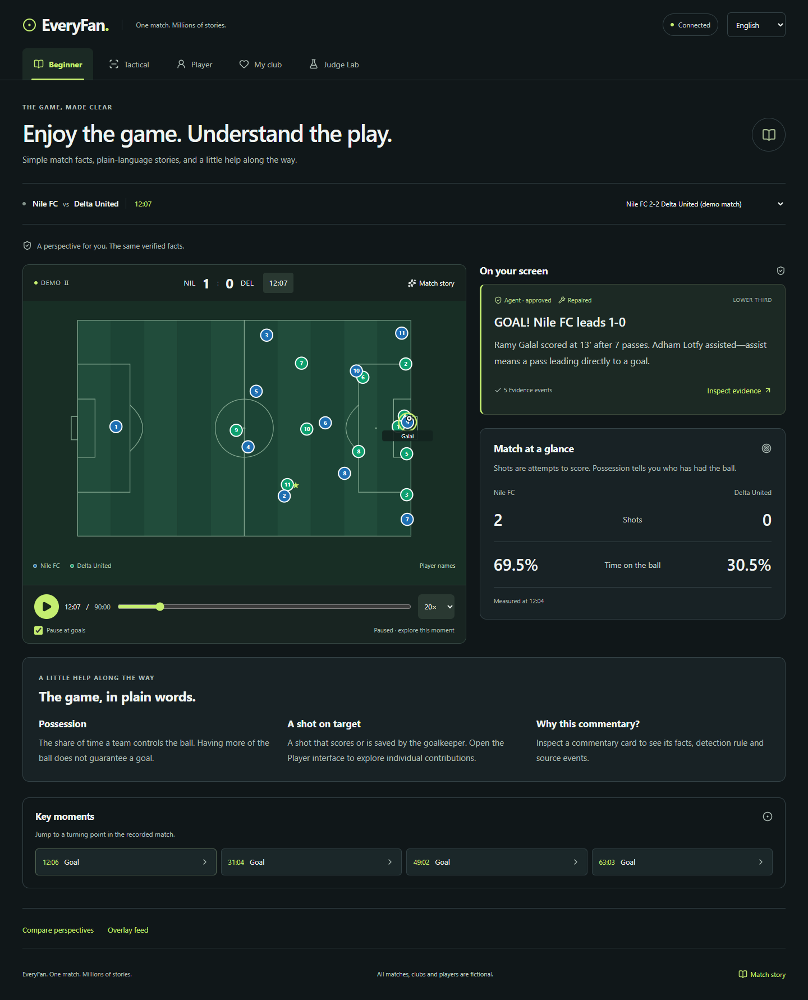
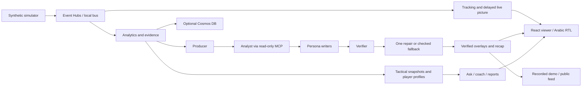

# EveryFan — One Match. Millions of Stories.

**▶ Try it live: https://everyfanviewer8414.z1.web.core.windows.net**
· API: https://everyfan-api.graybay-511bafbd.uaenorth.azurecontainerapps.io/docs
· Demo video: https://youtu.be/4loX-FDUKG4

Synthetic football events → verified match intelligence → personalised, timed broadcast overlays,
built on Microsoft Foundry, Agent Framework, Azure Event Hubs, Cosmos DB and Container Apps.

> All clubs, players and matches in this repository are fictional and generated by our simulator.

[Fan features](#fan-interfaces-and-statistics) · [Data and evidence](#data-evidence-and-playback) ·
[Local setup](#run-it-locally-no-azure-needed) · [Architecture](#architecture) ·
[API and MCP](#api-and-mcp) · [Evaluation](#evaluation) · [Documentation](#docs)

## Status

As of **28 October 2026**, the repository integrates the simulator, streaming/replay,
deterministic analytics, evidence API, Foundry agent workflow and React viewer.
It includes four independent fan interfaces, English/Arabic with RTL, continuous
match commentary, **eight advanced Player features, eight live Tactical features,
three additional agent experiences and seven read-only MCP tools**.

Validation includes **700 offline Python tests**, frontend unit/browser tests and
numeric-faithfulness evaluation. The public viewer and API are linked above.
The feature inventory below describes the current repository implementation;
deploy matching backend and frontend revisions when updating the hosted version.
Native Arabic editorial review and a deployed Foundry/live smoke check remain
release checks. The demo-video link is pending publication.

Start with the [judge walkthrough](docs/TESTING_GUIDE.md), the
[complete fan-data guide](docs/EVERYFAN_PROJECT_AND_FAN_DATA.md), or the
[advanced feature definitions](docs/ADVANCED_FEATURES_GUIDE.md).

## Try the project

1. Open the live viewer and select **Watch demo match**; no sign-in or model quota is needed.
2. Use **Beginner**, **Tactical**, **Player** and **My club** at the top. They share the same replay clock.
3. In Tactical, open **Live pitch** and toggle formation, shape, links, space control and other layers.
4. In Player, select a player and explore benchmarks, movement, sprints, output and matchups.
5. Open **Ask the match**, inspect its evidence, and try **Report so far**.
6. Switch to Arabic, inspect an event's evidence, and use **Judge Lab → Break it** to see an unsupported number rejected.

## Fan interfaces and statistics

Every interface shares the score, clock, tracking pitch, match selection, replay
controls, source timestamps, English/Arabic names and momentum timeline. Switching
fan type preserves the active match connection and selected player/club preferences.

| Interface | Core information |
| --- | --- |
| **Beginner** (`/#/beginner`) | Score, shots, possession, plain-language football explanations and “who is on top?” when measured control and momentum agree. Mixed signals remain a mixed/unclear edge, rather than a winner prediction. |
| **Tactical** (`/#/tactical`) | Possession, passing accuracy, PPDA and its component counts, control index, passing rate, passes per possession, mean pass distance, final-third pass share, duel win rate, shot conversion and mean shot distance. Includes selected-window versus match baselines, pass networks, territory, tracking average positions and shot maps. |
| **Player** (`/#/player`) | Goals, assists, shots/on target, key passes, pass attempts/completions/accuracy/distance, difficult completed passes, tackles, interceptions, distance covered, smoothed top speed, fastest measured shot, milestone badges and player moments. Includes top-five team distance/top-speed leaderboards, high-intensity distance and sprint counts. |
| **My club** (`/#/club`) | Selected-club goals, shots, possession, passing accuracy and PPDA versus the rival; up to three evidence-backed key moments, momentum and match counter-attack totals. Club commentary uses the selected `club_id`. |

Tactical event tables also expose forward passes gaining at least 10 m,
final-third/box entries, recoveries/high recoveries, tackles, interceptions,
duels, fouls and corners. Analysis windows are **last minute, 5 minutes,
15 minutes or match so far**. Counts and rate/percentage comparisons are kept
separate. Missing denominators are displayed as a dash.

### Eight advanced Player features

| Feature | What the viewer gets |
| --- | --- |
| **P1 — Role benchmark** | Radar and evidence table comparing the player with same-position peers from other matches only. Counts/distances use per-90 values; percentages and top speeds retain natural units. Peer IDs, medians and midrank percentiles are exposed. Comparisons are unreliable below 15 on-pitch minutes or without eligible peers. |
| **P2 — Live progress** | Raw values, benchmark percentiles and role-index progress at 15-minute checkpoints plus the current clock, with chart tooltips and a text table. |
| **P3 — EveryFan role index (heuristic)** | Transparent 0–10 weighted percentile index, with its formula, metric weights and contributions. Null until reliable; it is not a player rating or prediction. |
| **P4 — Heatmap and trail** | Raw tracking counts/shares on a 21 × 14 grid and a fading last-60-second movement trail in original pitch coordinates. |
| **P5 — Sprint map** | Sprint-bout arrows and a seekable list with start/end positions, duration, distance, period, maximum speed and frame evidence. A sprint uses smoothed speed strictly above 25.2 km/h for strictly more than one second. |
| **P6 — Physical output curve** | Distance/minute, high-intensity distance/minute, sprint count and top speed per 15-minute block, plus output relative to the first block. Uses on-pitch minutes; it does not diagnose fatigue. |
| **P7 — Direct matchup** | Closest opposing outfield player by mean separation over shared tracking frames, nearest-opponent frame share, explicitly recorded pair duels/tackles and side-by-side normalized statistics. Proximity is not treated as a duel. |
| **P8 — Off-ball runs** | Runs in own possession, at least 5 m from the ball, above 18 km/h smoothed speed and gaining at least 10 m in attacking depth. Includes box/final-third flags, seekable arrows and a known completed pass within three seconds of the endpoint. |

High-intensity distance uses the existing smoothed speed threshold of **19.8 km/h**.
Peer pools exclude the current match and require at least 30 minutes played in
another match. Substitutions and red cards affect on-pitch minutes. The role formula is
`10 × sum(weight × percentile / 100) / sum(weight)` over available configured metrics.
All thresholds, position groups and weights live in [analytics configuration](backend/analytics/config.yaml).

Benchmark groups are GK, FB (RB/LB), CB, MID (DM/CM), AM, W (RW/LW) and ST:

| Group | Benchmark metrics |
| --- | --- |
| All outfield groups | Completed passes, passing accuracy, distance, high-intensity distance and top speed. |
| FB / CB | Also tackles won, interceptions, duel win percentage and recoveries. |
| MID / AM | Also key passes, forward passes gaining at least 10 m and final-third entries. |
| W / ST | Also shots, shots on target, box entries and sprints. |
| GK | Saves, passing accuracy and distance. |

### Eight live Tactical features

The **Live pitch** tab has independent layer toggles, remembered in the browser.
Formation, shape and passing links are enabled initially. Labels and measurements
come from the backend; the browser draws the current-frame geometry.

| Feature | What the viewer gets |
| --- | --- |
| **T1 — Formation detection** | Separate with-ball/without-ball geometric formations, player lines, phase histories and a stable label held across three minutes. Shared pitches also show formation badges. |
| **T2 — Team shape** | Outfield convex hull, compactness area, width, length and defensive-line height, with current/window/match comparisons. |
| **T3 — Live passing links** | The top eight directed completed-pass links over the last five minutes, drawn between current player positions, with original source events. |
| **T4 — Nearest-player space control** | Voronoi drawing and backend 1 m-grid shares for the whole pitch, opponent half and attacking third. Includes goalkeepers; equal-distance ties belong to neither team. This is distance-only geometry, not a speed/physics pitch-control model. |
| **T5 — Defensive/offside lines** | Deepest outfield player and mean of the deepest four, current/window/match values and line-height history. The defending team's second-last player, including GK, supplies a position-only offside line; no offside decision is made. |
| **T6 — Line-breaking passes** | Completed forward passes bypassing at least three opponent outfield players, observed formation lines broken, match/window counts and evidence. Missing causal tracking within 0.5 seconds is reported as skipped. |
| **T7 — Counter-attacks** | Own-half ball win followed by an own-team shot within 15 seconds without opponent possession change; fast breaks within 10 seconds. Seekable chains retain event IDs, passes, duration and shot outcome. My Club compares counter totals. |
| **T8 — Pressing intensity** | Attack-normalized 6 × 4 pressure/tackle/interception/foul grid, counts or rate per minute, nearest team-player distance to the tracked ball and PPDA context. |

The existing passing/territory workbench remains available alongside Live pitch.
Pass-event network averages, tracking averages and phase formations are distinct
measurements. See [full definitions and evidence rules](docs/ADVANCED_FEATURES_GUIDE.md).

### Commentary, agents and supporting experiences

Routine **Match commentary** covers recorded passes, carries, shots, balls out,
corners, fouls, restarts, recoveries, duels, substitutions and other supported
actions. Calls wait for recorded action timing and use deterministic templates
and metadata names. Persona-specific analytical overlays follow the checked agent
workflow below; an action call is not presented as a fresh model inference.

| Experience | Behavior |
| --- | --- |
| **A1 — Ask the match** | Bilingual side drawer with six suggestions, up to four history items, as-of clock, source badge and evidence. Questions are limited to 300 characters and six/minute/client; at most three evidence tools are called. Guards reject injection, predictions and future facts; unknown players request clarification. Live structured routing handles entities/time ranges; demo free text uses deterministic routing/templates with zero model calls. |
| **A2 — Tactical coach** | Stable-ID notes for held formation changes, line-height shifts, compactness changes, pressing-zone shifts and repeated counters. Evaluated every 30 match-seconds with per-team/trigger cooldowns, before/after diagrams, evidence and seek links. Seek catch-up does not emit a burst. |
| **A3 — Match reports** | Dismissable automatic halftime/full-time reports and on-demand reports so far: score/scorers, verified moments, separate half/match tables, tactical picture, category leaders, coach observations and factual “what to watch.” |
| **Judge Lab / Break it** | Recorded demo and live entry points; a deterministic challenge shows an invented number rejected beside the checked replacement. |
| **Compare perspectives** | Read different persona/language explanations of the same play. |
| **Overlay feed / Match story** | Browse/search/filter published cards, inspect JSON/schema/evidence and open a recap with key-moment links. |

Ask, coach and report writing use verified facts, budget/deadline controls,
verification, one repair and deterministic fallback. In off mode, read endpoints
still serve deterministic notes/reports while heavy background agent preparation
is disabled to protect immediate commentary.

## Data, evidence and playback

Four reproducible synthetic matches are included:

| Match | Scenario |
| --- | --- |
| `match_001` | `derby_balanced` — main derby demo with changing control |
| `match_002` | `late_comeback` — late comeback |
| `match_003` | `red_card_60` — red card changes the match context |
| `match_004` | `press_vs_block` — high pressing against a low block |

The simulator supplies metadata, event records and **2 Hz** player/ball tracking
on a **105 × 68 m** pitch, with a continuous 90-minute clock. Home attacks +x and
away −x in both halves. It uses no professional-match data or licensed footage.

Core analytics also exposes control, chaos, rhythm and momentum snapshots.
The moment detector identifies goals, red cards, big chances, momentum/pressing/
rhythm shifts, control-to-chaos changes, killer passes and player milestones.
Rules, thresholds and formulas are documented in [Owner B's guide](docs/OWNER_B.md).

- **Code computes football statistics; agents explain them.** Event values retain
  source IDs; tracking measurements retain frame ranges and sample counts.
- **As-of cutoffs prevent future leakage.** Windows use `(at_s − window_s, at_s]`,
  clipped to kickoff; whole-match tracking also includes the kickoff sample.
  Peer comparisons use other matches, never current-match future data.
- **Evidence stays inspectable.** Cards expose facts, detector rules, source
  events, original tracking samples and trace IDs when available. Frozen shared
  contracts remain unchanged.
- **Honest labels matter.** The role index and pass-difficulty measure are
  heuristics; space control is distance-only; physical output is not a fatigue
  diagnosis. The project does not fabricate xG, player ratings or forecasts.

| Mode | Playback and model behavior |
| --- | --- |
| **Watch demo match** | Private clock, pause, seek and speed per viewer. Recorded overlays and deterministic/precomputed extras play without model calls or Event Hubs traffic. |
| **Run live** | Shared broadcast; its host controls playback and other viewers join read-only. Uses local transport or configured Event Hubs. Models run only when configured/enabled, under the live token budget. The live picture defaults to a six-second delay. |

Each of the four demo bundles includes **20 advanced reports, ten coach variants
and 144 suggested Q&A records**: **80 reports and 576 suggested answers** overall.
Stub-generated advanced prose is labelled as a template. Existing recorded
overlays, recaps and fingerprints are preserved.



## Repository layout

```text
shared/schemas/        frozen contracts A, A2, B, C, D, E + stream envelope (+ JSON Schema copies)
backend/simulator/     match engine, 2 Hz tracking, scenarios, validator, replay controller
backend/services/      stream transports (local + Event Hubs), consumer, rate limiter, token budget
backend/api/           FastAPI: replay control, live + demo WebSockets, plugin pipeline, template overlays
backend/analytics/     metrics, indices, moments, evidence API, Cosmos DB  (Owner B, as a pipeline plugin)
backend/agents/        Foundry agents, workflow, MCP server, verifier    (Owner C, as a pipeline plugin)
evals/                 eval dataset, numeric-faithfulness evaluator, agent eval runner
frontend/              React viewer                                       (Owner D)
demo/                  cached demo-match bundles (Judge mode)
deployment/            Bicep template + one-command deploy / update scripts
tests/                 contracts, determinism, realism, streaming, API
docs/                  OWNER_A.md · OWNER_B.md · API.md · DEPLOYMENT.md
```

## Run it locally (no Azure needed)

Requirements: **Python 3.12**, **Node 22.12+**, npm and Git. For a fresh Windows
checkout, run the following in PowerShell. If already cloned, start with the
virtual-environment step from the repository root:

```powershell
git clone https://github.com/AbdelrahmanOs77/everyfan.git
cd everyfan
py -3.12 -m venv .venv/py312
$python = '.\.venv\py312\Scripts\python.exe'
& $python -m pip install -r requirements-dev.txt
$env:AGENT_MODE='off'
$env:STREAM_TRANSPORT='local'
$env:FRONTEND_ORIGIN='http://localhost:5173'
$env:BUDGET_FILE=Join-Path (Get-Location) '.venv/local-budget.json'
& $python -m backend.cli generate --all
& $python -m backend.cli validate --all
& $python -m backend.cli serve
```

An existing checkout can reuse `.venv/py312/Scripts/python.exe` and skip virtual
environment creation. On Linux/macOS, create/activate a Python 3.12 virtual
environment and run the same Python modules with `python` in place of `& $python`.
The API is at **http://localhost:8000/docs**. Leave optional cloud settings unset
for local use; `.env.example` documents the available configuration.

With the API running, start the viewer in a second terminal:

```bash
cd frontend
npm ci
npm run dev                                    # open http://localhost:5173
```

The Vite development proxy forwards `/api` and `/ws` to localhost:8000. Choose
**Watch demo match** for zero-model-cost playback. The default pipeline is
`backend.analytics.plugin:register,backend.agents.plugin:register`; loading the
legacy `backend.api.template_plugin:register` alongside it would duplicate goals.

### Configuration

| Setting | Purpose |
| --- | --- |
| `STREAM_TRANSPORT` | `local` bus or configured `eventhubs` transport. |
| `AGENT_MODE` | `off` for deterministic templates, `stub` for offline workflow tests, `foundry` for configured model calls. |
| `AGENT_TOOLS` | `inprocess` providers or the authenticated `mcp` transport. |
| `MCP_SERVER_URL`, `MCP_API_KEY` | MCP address and shared server/client credential for HTTP access. |
| `FOUNDRY_PROJECT_ENDPOINT`, `FOUNDRY_MODEL_FAST`, `FOUNDRY_MODEL_STRONG` | Foundry project and model deployments; Entra ID/managed identity or a private resource key can authenticate. |
| `LIVE_MODE_DAILY_TOKEN_CAP`, `BUDGET_FILE` | Shared model budget and persisted accounting; stage deadlines also bound model work. |
| `FRONTEND_ORIGIN` | Backend CORS origin allowlist. |
| `VITE_API_BASE_URL` | Optional frontend build-time API URL. Public configuration only; credentials belong on the backend. |
| `COSMOS_ENDPOINT`, `COSMOS_DATABASE` | Optional Cosmos DB persistence; cloud authentication/configuration is described in the deployment guides. |
| `BROADCAST_DELAY_S`, `ALLOWED_SPEEDS` | Live picture delay and permitted live replay speeds. |
| `ANALYTICS_CONFIG` | Optional analytics YAML override for formulas, thresholds, grids and role weights. |

Never commit `.env`, `.env.azure`, keys, tokens or `deployment/.admin-token`.

### Tests and reproducible checks

From the repository root, using the project virtual environment:

```powershell
$python = '.\.venv\py312\Scripts\python.exe'
$env:AGENT_MODE='off'
& $python -m pytest -q
& $python -m pyflakes backend shared tests
& $python -m evals.run_agent_eval --mode stub --inject 0.3 --quiet --no-write
& $python -m evals.run_ask_eval --mode stub --inject 0.3
& $python -m evals.run_advanced_performance
```

In `frontend/`:

```bash
npm run format:check
npm test
npm run build
npm audit --audit-level=high
npm run test:e2e
```

There is no separate npm lint script; `format:check` is the existing formatting
gate. Playwright uses installed Chrome locally and isolated Chromium in CI.
Browser coverage includes fan navigation, English/Arabic RTL, responsive and
accessibility checks, evidence, advanced features, full replay and live controls.
Tests use off/stub modes, never Azure or a real model. CI also validates scenarios,
checks frozen JSON Schemas and compiles the Bicep templates.

To rebuild only the advanced offline recordings for all four matches:

```powershell
& $python -m backend.agents.record_demo --advanced-only --mode stub --out demo
```

## Architecture



Python/FastAPI serves REST and WebSockets; deterministic Python/NumPy analytics
build cached possession, tracking, tactical and player indexes. React, TypeScript
and Vite render the viewer; D3 Delaunay draws Voronoi geometry and Lucide supplies
icons. Microsoft Agent Framework connects configured Foundry deployments.
Azure integrations cover Event Hubs, Cosmos DB, Container Apps and optional
Application Insights/OpenTelemetry tracing.

## API and MCP

The viewer reads the following sources; [API.md](docs/API.md) contains full
parameters, response shapes, validation rules and error codes.
Abbreviated match paths in the table share the `/api/matches/{id}` prefix.

| Interface | Main endpoints |
| --- | --- |
| Discovery/state | `GET /api/health`, `/api/scenarios`, `/api/matches/{id}/metadata`, `/api/matches/{id}/state` |
| Core statistics | `GET /api/matches/{id}/stats`, `/players/{pid}/stats`, `/advanced-stats`, `/fan-stats`, `/baseline` |
| Advanced Player/Tactical | `GET /api/matches/{id}/players/{pid}/profile?at_s=&window_s=&sections=`, `/tactics?at_s=&window_s=` |
| Original evidence | `GET /api/matches/{id}/events`, `/events/{event_id}`, `/moments`, `/evidence/{moment_id}`, `/players/{pid}/tracking-samples` |
| Agent experiences | `POST /api/matches/{id}/ask`; `GET /api/matches/{id}/coach-notes`, `/report?phase=half\|full\|so_far` |
| Feed/story/judge tools | `GET /api/matches/{id}/overlays`, `/recap`; `POST /api/demo/break-it` |
| Live replay control | `POST /api/matches/{id}/start`, `/pause`, `/resume`, `/speed`, `/seek`, `/stop`. Starting returns a host token; subsequent controls require the host/admin credential. |
| Streams | `WS /ws/demo/{id}` for private recorded playback; `WS /ws/matches/{id}` for the shared broadcast. |

Advanced responses include definitions and event/frame evidence. Half/full
reports are unavailable before their phase cutoff. Ask takes `question`, `at_s`,
`persona`, `language`, optional player/club IDs and bounded history; `source=demo`
keeps answers deterministic/precomputed, while `source=live` can use configured models.

## Deploy

The public viewer currently uses Azure Storage static website hosting; the API
runs on Azure Container Apps. Infrastructure/deployment tooling also includes
Static Web Apps templates. See [DEPLOYMENT.md](docs/DEPLOYMENT.md),
[Owner A's runbook](docs/OWNER_A.md) and [viewer setup](docs/OWNER_D.md).

`./deployment/deploy.ps1 -Location <allowed-region> -Image ghcr.io/<owner>/<repo>-backend:latest`
is the infrastructure deployment entry point. GitHub Actions builds, smoke-tests
and publishes backend images when relevant runtime files change. README/docs-only
edits do not trigger that image workflow. Owner A coordinates backend/frontend
release updates and the deployed live smoke check. Local deterministic operation
does not require any Azure deployment.

## Evaluation

These measurements distinguish numeric-token faithfulness from overall language
quality, semantic correctness or live model latency.

### Recorded Foundry and adversarial-overlay evaluation

Measured on 26 October 2026 using the 30-moment sample (seed 7).

| Metric | Foundry, no injection | Offline stub, 30% injection |
| --- | ---: | ---: |
| Moments / persona-language-club slots | 30 / 236 | 30 / 236 |
| Valid first drafts / missing first drafts | 211 / 25 | 236 / 0 |
| Raw numeric faithfulness, before Verifier | 91.0% (192/211) | 66.1% (156/236) |
| Published numeric faithfulness, after repair/fallback | **100.0% (236/236)** | **100.0% (236/236)** |
| Approved drafts | 149 (63.1%) | 236 (100.0%) |
| Checked template fallbacks | 87 (36.9%) | 0 (0.0%) |
| Repairs attempted | 70 | 80 |
| Deliberately injected drafts | 0 | 80 |

The Foundry sample spans four matches and is balanced by moment type; raw scores
cover valid first drafts, with missing drafts reported separately.
All final outputs passed the numeric check, including checked template fallbacks;
this is a numeric-token metric rather than an overall quality score.
The separate offline challenge caught and repaired all 80 injected drafts.

The real run used `everyfan-fast` for Analyst, writers and Verifier, in-process
evidence tools, 20-second stage deadlines and 24,000 charged tokens/minute pacing.
This evaluates offline quality and verifier behavior, not live latency. It used
519,131 provider-reported tokens in 502 completion calls; conservative charges were
519,131, with 0 unknown-usage calls. Model-based quality judges were not run.

See the [Foundry report](evals/results/latest.md),
[raw/final Foundry records](evals/results/20261026-203019-foundry.json),
[evidence and coverage audit](evals/results/20261026-203019-foundry.audit.json), and
[offline injection report](evals/results/stub-injected.md).
The [review record](docs/OWNER_C_STEP5.md#review-outcome-and-step-6-handoff)
documents this evaluation's integration handoff.

### Advanced Ask and endpoint measurements

| Check | Recorded result |
| --- | --- |
| Bilingual offline Ask dataset | 44 questions across supported intents, entities, prompt injection, predictions and future guards. |
| Raw first-draft numeric faithfulness with selected injected false numbers | 64.71% across 34 generated drafts. |
| Published Ask numeric faithfulness | **100%**. |
| Ask refusal correctness / expected facts and intents | **100% / 100%** on the dataset. |
| Actual Tactical HTTP endpoint, warm p95 | **99.73 ms**, 20 changing clocks on `match_001`. |
| Actual Player profile HTTP endpoint, warm p95 | **71.15 ms**, 20 changing clocks on `match_001`. |
| Cold Tactical / profile request | About **3.53 s / 7.34 s**, including index/reference preparation; loading/retry states cover this work. |

Ask uses an explicit provider warm-up in its offline latency evaluation. Workflow
deadline exhaustion returns an evidence-unavailable fallback rather than an
unchecked answer. These are local/offline measurements, not a deployed SLA or
proof of native Arabic editorial quality. Sources:
[Ask results](docs/ASK_EVAL_RESULTS.json),
[endpoint measurements](docs/ADVANCED_PERFORMANCE.json),
[advanced implementation status](docs/ADVANCED_IMPLEMENTATION_STATUS.md).

## Agents, MCP and Foundry

The Producer plans overlays by persona, language and favorite club. The Analyst
reads verified match evidence; persona writers draft the copy, and the Verifier
checks contracts, numbers, names and evidence before its semantic check. A
rejected draft gets one repair attempt, then a checked template fallback. Agents
use measured facts rather than calculating football statistics.

The Analyst can read the same evidence in-process or through the **seven read-only
MCP tools** mounted at `/mcp/` (`AGENT_TOOLS=mcp`):

1. `get_match_state`
2. `get_recent_events`
3. `get_player_statistics`
4. `get_moment_evidence`
5. `compare_to_baseline`
6. `get_tactical_snapshot`
7. `get_player_profile`

HTTP MCP access uses the configured API key; missing/wrong credentials are
rejected. REST and MCP share the deterministic evidence providers. Microsoft Agent Framework calls
the configured Foundry fast/strong deployments with a shared token budget;
authentication supports Entra ID or a private resource key for cross-tenant
deployment. Numeric/name/evidence/tone checks, future/prediction guards for the
new experiences, one repair and checked fallbacks bound publication. Telemetry
and optional audit/brief persistence record workflow outcomes without logging
free-text Ask questions. Cached demo overlays, recaps and advanced recordings play
without model calls. See
[Owner C's implementation notes](docs/OWNER_C.md) and the
[evaluation report](docs/OWNER_C_STEP5.md) for measured results and run settings.

## Docs

- [docs/TESTING_GUIDE.md](docs/TESTING_GUIDE.md) — live judge walkthrough
- [docs/EVERYFAN_PROJECT_AND_FAN_DATA.md](docs/EVERYFAN_PROJECT_AND_FAN_DATA.md) — full project and per-fan data inventory
- [docs/ADVANCED_FEATURES_GUIDE.md](docs/ADVANCED_FEATURES_GUIDE.md) — all eight Player, eight Tactical and three agent features, formulas, evidence and limitations
- [docs/OWNER_A.md](docs/OWNER_A.md) — simulator, scenarios, streaming, how teammates plug in
- [docs/OWNER_B.md](docs/OWNER_B.md) — formulas, thresholds, moment rules, evidence API, Cosmos DB
- [docs/API.md](docs/API.md) — REST + WebSocket contract for the frontend, plugin interface for analytics and agents
- [docs/OWNER_C.md](docs/OWNER_C.md) — agents, workflow, Verifier, MCP, tracing, Favorite Club, Recap, evals
- [docs/DEPLOYMENT.md](docs/DEPLOYMENT.md) — Azure deployment and judging-period runbook
- [docs/INTEGRATION.md](docs/INTEGRATION.md) — how A, B and C fit together; go-live steps
- [docs/HANDOFF_OWNER_D.md](docs/HANDOFF_OWNER_D.md) — everything the frontend needs
- [docs/OWNER_D.md](docs/OWNER_D.md) — viewer, verification and deployment setup
- [docs/OWNER_D_DELIVERY.md](docs/OWNER_D_DELIVERY.md) — English pitch, video and submission handoff

## Assets and implementation disclosure

Matches, names, teams, tracking and football imagery are synthetic. The viewer
uses no real-club marks, external fonts or copyrighted match footage. React is
MIT-licensed; Lucide icons use ISC; Vite, TypeScript, Playwright, Vitest and
Prettier retain their upstream licenses. The frontend was implemented with
Codex assistance. Separate GitHub Copilot Agent Mode usage, if any, must be
documented by the team from actual work. Optional features and unverified cloud
claims are listed explicitly in the delivery notes.
