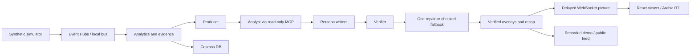

# EveryFan — One Match. Millions of Stories.

Synthetic football events → verified match intelligence → personalised, timed broadcast overlays,
built on Microsoft Foundry, Agent Framework, Azure Event Hubs, Cosmos DB and Container Apps.

> All clubs, players and matches in this repository are fictional and generated by our simulator.

## Status

Backend complete and integrated (Owners A, B, C): simulator → Event Hubs → analytics → Foundry agents
(Producer, Analyst over MCP, persona writers, Verifier with repair, Recap) → verified overlays on WebSockets,
a public overlay feed and match recaps. Personas: Beginner, Tactical, Player Focus, Favorite Club; English and
Arabic. 583 offline tests. The React viewer now includes the tracking pitch,
four-way comparison, Arabic RTL, evidence, measured indices, recaps and Judge
mode. Public frontend hosting awaits a subscription permitting Azure Static Web
Apps regions and the backend CORS update; there is no live frontend URL yet.
See [Owner D status](docs/OWNER_D.md) and the [testing guide](docs/TESTING_GUIDE.md).

The latest local viewer has separate Beginner, Tactical, Player and My Club
interfaces. Tactical adds server-calculated advanced statistics, rolling-window
baselines, pass networks, territory and shot maps. See the
[fan-interface/API definitions](docs/OWNER_D_FAN_INTERFACES.md); this extension
requires deploying the updated backend along with the frontend.


## Repository layout

```text
shared/schemas/        frozen contracts A, A2, B, C, D, E + stream envelope (+ JSON Schema copies)
backend/simulator/     match engine, 2 Hz tracking, scenarios, validator, replay controller
backend/services/      stream transports (local + Event Hubs), consumer, rate limiter, token budget
backend/api/           FastAPI: replay control, live + demo WebSockets, plugin pipeline, template overlays
backend/analytics/     metrics, indices, moments, evidence API, Cosmos DB  (Owner B, as a pipeline plugin)
backend/agents/        Foundry agents, workflow, MCP server, verifier    (Owner C, as a pipeline plugin)
evals/                 eval dataset, numeric-faithfulness evaluator, agent eval runner
frontend/              React viewer                                       (Owner D)
demo/                  cached demo-match bundles (Judge mode)
deployment/            Bicep template + one-command deploy / update scripts
tests/                 contracts, determinism, realism, streaming, API
docs/                  OWNER_A.md · OWNER_B.md · API.md · DEPLOYMENT.md
```

## Run it locally (no Azure needed)

```bash
pip install -r requirements-dev.txt
python -m backend.cli generate --all
python -m backend.cli serve                      # http://localhost:8000/docs
python -m backend.cli smoke --url http://localhost:8000 --live
pytest -q
python -m evals.run_agent_eval --mode stub --inject 0.3    # Verifier gate, offline
```

With the API running, start the viewer in a second terminal (Node 22.12+):

```bash
cd frontend
npm ci
npm run dev                                    # open http://localhost:5173
npm test
npm run build
npm run test:e2e                               # local off-mode API only
```

Use `AGENT_MODE=off` for local browser testing. Playwright uses installed Chrome
on Windows and isolated Chromium in CI. **Watch demo match → Break it → switch
to Arabic → pick a player** is the quick judge flow. Recorded demo output makes
no model calls. Run live uses the shared live budget.

## Architecture



## Deploy

`./deployment/deploy.ps1 -Location <allowed-region> -Image ghcr.io/<owner>/<repo>-backend:latest` —
see [docs/DEPLOYMENT.md](docs/DEPLOYMENT.md). Images are built, smoke-tested and published by GitHub Actions.

## Evaluation

Measured on 2026-10-26 20:51 UTC using the 30-moment sample (seed 7).

| Metric | Foundry, no injection | Offline stub, 30% injection |
| --- | ---: | ---: |
| Moments / persona-language-club slots | 30 / 236 | 30 / 236 |
| Valid first drafts / missing first drafts | 211 / 25 | 236 / 0 |
| Raw numeric faithfulness, before Verifier | 91.0% (192/211) | 66.1% (156/236) |
| Published numeric faithfulness, after repair/fallback | **100.0% (236/236)** | **100.0% (236/236)** |
| Approved drafts | 149 (63.1%) | 236 (100.0%) |
| Checked template fallbacks | 87 (36.9%) | 0 (0.0%) |
| Repairs attempted | 70 | 80 |
| Deliberately injected drafts | 0 | 80 |

The Foundry sample spans four matches and is balanced by moment type; raw scores
cover valid first drafts, with missing drafts reported separately.
All final outputs passed the numeric check, including checked template fallbacks;
this is a numeric-token metric rather than an overall quality score.
The separate offline challenge caught and repaired all 80 injected drafts.

The real run used `everyfan-fast` for Analyst, writers and Verifier, in-process
evidence tools, 20-second stage deadlines and 24,000 charged tokens/minute pacing.
This evaluates offline quality and verifier behavior, not live latency. It used
519,131 provider-reported tokens in 502 completion calls; conservative charges were
519,131, with 0 unknown-usage calls. Model-based quality judges were not run.

See the [Foundry report](evals/results/latest.md),
[raw/final Foundry records](evals/results/20261026-203019-foundry.json),
[evidence and coverage audit](evals/results/20261026-203019-foundry.audit.json), and
[offline injection report](evals/results/stub-injected.md).
The user performed the requested review in place of Owner B and merged PR #5;
see [the recorded review outcome](docs/OWNER_C_STEP5.md#review-outcome-and-step-6-handoff).

## Agents, MCP and Foundry

The Producer plans overlays by persona, language and favorite club. The Analyst
reads verified match evidence; persona writers draft the copy, and the Verifier
checks contracts, numbers, names and evidence before its semantic check. A
rejected draft gets one repair attempt, then a checked template fallback. Agents
use measured facts rather than calculating football statistics.

The Analyst can read the same evidence in-process or through the five read-only
MCP tools mounted at `/mcp/` (`AGENT_TOOLS=mcp`). Microsoft Agent Framework calls
the configured Foundry fast/strong deployments with a shared token budget;
authentication supports Entra ID or a private resource key for cross-tenant
deployment. Cached demo overlays and recaps play without model calls. See
[Owner C's implementation notes](docs/OWNER_C.md) and the
[evaluation report](docs/OWNER_C_STEP5.md) for measured results and run settings.

## Docs

- [docs/OWNER_A.md](docs/OWNER_A.md) — simulator, scenarios, streaming, how teammates plug in
- [docs/OWNER_B.md](docs/OWNER_B.md) — formulas, thresholds, moment rules, evidence API, Cosmos DB
- [docs/API.md](docs/API.md) — REST + WebSocket contract for the frontend, plugin interface for analytics and agents
- [docs/OWNER_C.md](docs/OWNER_C.md) — agents, workflow, Verifier, MCP, tracing, Favorite Club, Recap, evals
- [docs/DEPLOYMENT.md](docs/DEPLOYMENT.md) — Azure deployment and judging-period runbook
- [docs/INTEGRATION.md](docs/INTEGRATION.md) — how A, B and C fit together; go-live steps
- [docs/HANDOFF_OWNER_D.md](docs/HANDOFF_OWNER_D.md) — everything the frontend needs
- [docs/OWNER_D.md](docs/OWNER_D.md) — viewer, verification and Azure hosting dependency
- [docs/TESTING_GUIDE.md](docs/TESTING_GUIDE.md) — judge walkthrough
- [docs/OWNER_D_DELIVERY.md](docs/OWNER_D_DELIVERY.md) — English pitch, video and submission handoff

## Assets and implementation disclosure

Matches, names, teams, tracking and football imagery are synthetic. The viewer
uses no real-club marks, external fonts or copyrighted match footage. React is
MIT-licensed; Lucide icons use ISC; Vite, TypeScript, Playwright, Vitest and
Prettier retain their upstream licenses. The frontend was implemented with
Codex assistance. Separate GitHub Copilot Agent Mode usage, if any, must be
documented by the team from actual work. Optional features and unverified cloud
claims are listed explicitly in the delivery notes.
