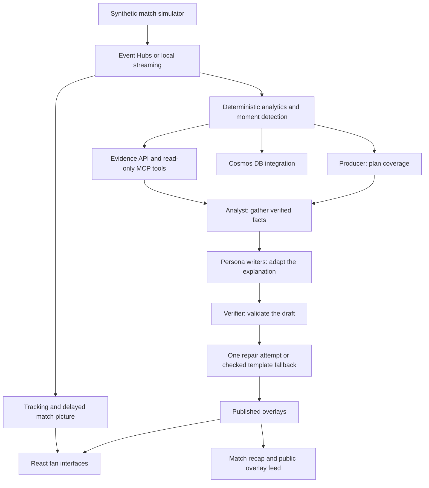

# EveryFan — Project Overview and Fan Data Guide

**Documentation date:** 27 October 2026  
**Tagline:** One Match. Millions of Stories.  
**Repository:** [AbdelrahmanOs77/everyfan](https://github.com/AbdelrahmanOs77/everyfan)

This document describes the implemented project and the information currently
shown in each fan interface. It separates measured statistics, generated
commentary, and features that still need deployment or human review.

## 1. What EveryFan does

EveryFan turns a synthetic football match into a personalised viewing experience.
Everyone watches the same underlying match, but the interface, commentary and
statistical detail change according to the fan's interests.

| Fan type | Main question | Interface approach |
|---|---|---|
| Beginner | What is happening, and what does it mean? | Clear commentary, basic comparisons and football explanations |
| Tactical | How are the teams playing, and what is changing? | Advanced metrics, rolling comparisons, passing networks and event maps |
| Player | How is my selected player performing? | Individual contributions, physical performance, badges and shot evidence |
| My club | How is my team doing? | Club-focused commentary and the selected team's match summary |

The interface changes the presentation and emphasis. It does not change the
underlying facts or create different versions of the score.

## 2. Architecture and responsibilities



### Main components

| Component | Responsibility | Main location |
|---|---|---|
| Simulator | Generate fictional matches, events and player/ball tracking | `backend/simulator/` |
| Streaming and replay | Transport events, control playback and maintain match state | `backend/services/`, `backend/api/` |
| Analytics | Calculate statistics and detect significant moments | `backend/analytics/` |
| Advanced analytics | Calculate windowed comparisons, networks and spatial evidence | `backend/analytics/advanced.py` |
| Agents | Produce evidence-grounded explanations and recaps | `backend/agents/` |
| Viewer | Render the different fan experiences, controls and evidence | `frontend/` |
| Evaluation | Measure numeric faithfulness and challenge verification | `evals/` |
| Deployment | Azure infrastructure and deployment configuration | `deployment/` |

The backend uses Python/FastAPI. The frontend uses React, TypeScript and Vite.
Agent integration uses Microsoft Agent Framework and Foundry. Azure integrations
include Event Hubs, Cosmos DB and Container Apps; Static Web Apps deployment
configuration is prepared for the frontend.

These are implemented capabilities and deployment targets. They do not imply
that every cloud component or the latest revision is already deployed.

### Agent workflow

1. **Producer:** decides which perspectives should cover a detected moment.
2. **Analyst:** gathers the moment's measured facts and evidence.
3. **Persona writers:** explain those facts for the chosen fan type and language.
4. **Verifier:** checks contracts, numbers, entities and evidence, with additional
   model-based checks when configured.
5. **Repair/fallback:** a rejected draft receives one repair attempt; if necessary,
   a checked template replaces it.
6. **Recap:** builds a story from published, verified material.

The Analyst can use five read-only MCP evidence capabilities: match state,
recent events, player statistics, moment evidence and baseline comparisons.

## 3. Match data and its origin

All clubs, players and matches are fictional. The application does not depend on
licensed real-world football footage or live professional match data.

### Available scenarios

| Match | Scenario | Purpose |
|---|---|---|
| `match_001` | `derby_balanced` | Main recorded demo: a balanced derby with changing control |
| `match_002` | `late_comeback` | A late comeback |
| `match_003` | `red_card_60` | A red card changes the match context |
| `match_004` | `press_vs_block` | High pressing against a low block |

### Data layers

| Data layer | Examples | How it is used |
|---|---|---|
| Match metadata | Team/player IDs, English/Arabic names, shirt numbers, positions, colours | Identity, selectors, pitch labels and localisation |
| Event stream | Passes, carries, recoveries, tackles, interceptions, duels, shots, goals, fouls, cards, corners | Statistical calculations and event evidence |
| Tracking | Player positions and ball position at 2 Hz | Pitch animation, distance and measured top speed |
| Analytics snapshots | Possession, passing, pressure and match indices | Basic and advanced dashboards |
| Detected moments | Goals, big chances, pressing shifts, momentum shifts, milestones | Commentary triggers and highlight navigation |
| Published overlays | Persona, language, text, timing, verification status, evidence IDs | Timed commentary cards |
| Recaps | Headline, story, key moments and provenance | Match story so far or final recap |

The pitch is 105 × 68 metres. Matches use a continuous 90-minute clock without
stoppage time. In the synthetic coordinate system, the home team attacks toward
increasing x and the away team toward decreasing x in both halves.

**Statistical calculations run in the backend.** The browser formats the values,
filters records and draws visualisations; agents do not calculate football
statistics or invent missing measurements.

## 4. Information shared across fan interfaces

- Match selection and fictional team/player metadata.
- The same score, match clock, ball and player tracking.
- Replay controls: play/pause, seeking and supported playback speeds.
- English and Arabic, including RTL layout and Arabic metadata names.
- Commentary matching the selected fan type.
- Highlight navigation and a match-story recap.
- Evidence inspection: facts, detection rule, source events and a trace ID when
  one is attached.

Changing fan type keeps the existing match connection and replay clock. Player
and club choices are retained. The app automatically chooses the matching
commentary persona for each fan interface.

## 5. Beginner interface

**Route:** `/#/beginner`  
**Goal:** make the match understandable without overwhelming the viewer.

### Statistics displayed

| Information | Meaning | Scope/source |
|---|---|---|
| Score | Goals for each team | Current streamed match state |
| Match clock | Current position in the replay | Tracking/state stream |
| Shots | Attempts to score by each team | Match-to-date analytics snapshot |
| Possession | Each team's share of measured possession time | Match-to-date analytics snapshot |
| Measurement timestamp | Time represented by the statistics | Backend snapshot timestamp |
| Who is on top right now? | Plain-language edge only when control and momentum agree; otherwise mixed/insufficient | Backend `fan-stats`, existing last-five-minute control and decaying momentum |
| Momentum over time | Both teams' attacking activity through the current clock, with source events | Backend minute samples plus current time |

### Supporting experience

- A prominent pitch and easy replay controls.
- Beginner commentary in plain language.
- Short explanations of possession, shots on target and commentary evidence.
- An evidence button for viewers who want to investigate a claim.

The Beginner interface deliberately omits the detailed tactical workbench.

## 6. Tactical interface

**Route:** `/#/tactical`  
**Goal:** explain team performance, pressure, progression and territory in detail.

### Controls and comparison scopes

- Select either team.
- Select the **last minute**, **last 5 minutes**, **last 15 minutes**, or
  **match so far**.
- Compare rates/percentages for the selected window with the match-to-date
  baseline at the same timestamp.
- Read the server-calculated difference between the two values.
- Switch between **Performance & pressure**, **Passing & territory**, and
  **Shots & actions**.

### A. Performance and pressure

| Metric | Meaning | Unit |
|---|---|---|
| Possession | Share of measured possession time | % |
| Pass accuracy | Completed passes divided by attempted passes | % |
| PPDA | Opponent passes in their own 60% divided by our qualifying defensive actions in that zone | Ratio |
| PPDA opponent-pass count | Numerator used by the PPDA calculation | Events |
| PPDA defensive-action count | Tackles, interceptions and fouls used by the calculation | Events |
| Control index | Existing weighted combination of pass accuracy, possession and passes per possession | Index |
| Passes per minute | Pass attempts divided by elapsed minutes in the scope | Passes/min |
| Passes per possession | Existing backend measure of passing within possession sequences | Ratio |
| Mean pass distance | Average geometric length of measured pass attempts | Metres |
| Final-third pass share | Team share of both teams' completed passes ending in their respective attacking third | % |
| Duel win rate | Won duels divided by recorded duels | % |
| Shot conversion | Shot events with outcome `goal` divided by shot events | % |
| Mean shot distance | Average distance from the shot origin to the opponent goal centre | Metres |

The headline cards emphasise PPDA, control index, final-third pass share and pass
rate. The comparison table exposes the wider set of rates and percentages.

### B. Passing and territory

| Information | What it shows |
|---|---|
| Passing network | Directed completed-pass connections between teammates |
| Network link count | Completed passes along a displayed connection |
| Network node position | Backend average of observed pass origins/receptions for that player |
| Territory grid | Counts of completed-pass endpoints in a 6 × 4 grid |
| Tracking average positions | Per-player arithmetic mean of actual tracking samples in the selected window, grouped by team |
| Position evidence | Measured x/y coordinates, sample counts, frame range and paginated original tracking samples |
| Pass attempts | Pass events in the selected window |
| Completed passes | Passes with outcome `completed` |
| Forward passes ≥10 m | Completed passes gaining at least 10 metres along the team's attacking x direction |
| Final-third entries | Completed passes/carries entering the attacking third from outside it |
| Box entries | Completed passes/carries entering the opponent penalty box from outside it |

The network displays up to twelve strongest links. Link and node records retain
source event IDs. Network positions are **not formation positions or off-ball
tracking positions**. The territory grid is **not a player heatmap**.
The separate **Average positions from tracking** map uses actual player positions.
It is a sample mean, not a fixed formation. Original pitch coordinates are used:
home attacks towards increasing x, away towards decreasing x. The momentum
timeline is also available below the Tactical workbench.

### C. Shots and actions

| Group | Statistics/details displayed |
|---|---|
| Shooting | Shots, shots on target, shot-origin map, outcome, shot time, shooter and distance |
| Recoveries | Ball recoveries and recoveries in the attacking third |
| Defensive actions | Tackles won and interceptions |
| Duels | Won duels; duel win rate is also in the performance table |
| Discipline | Fouls committed |
| Set pieces | Corners |
| Passing/progression | Pass attempts/completions, forward passes and third/box entries in the two-team event table |
| Evidence | Links to the actual shot and pass source records |

Shot outcomes distinguish goals, saved shots, blocked shots, off-target shots and
shots hitting the post. The shot map has a textual evidence table as well.

## 7. Player interface

**Route:** `/#/player`  
**Goal:** follow one player's contribution and physical performance.

### Profile and selection

- Select a player from either team.
- See their English/Arabic name, club, shirt number and playing position.
- Selecting a player dot on the pitch opens the Player interface for that player.

### Statistics displayed

| Group | Statistic | Unit/representation |
|---|---|---|
| Attacking contribution | Goals | Count |
| Attacking contribution | Assists | Count |
| Shooting | Shots | Count |
| Shooting | Shots on target | Count |
| Creation | Key passes | Count |
| Passing | Completed passes | Count |
| Passing details | Pass attempts | Count |
| Passing details | Pass completion rate | Backend ratio formatted as a percentage |
| Passing details | Total pass distance | Metres |
| Passing details | Difficult completed passes | Existing backend difficulty-threshold count |
| Defensive contribution | Tackles won | Count |
| Defensive contribution | Interceptions | Count |
| Physical performance | Distance covered | Kilometres |
| Physical performance | Top speed | km/h |
| Shooting details | Fastest measured shot | km/h |
| Milestones | Earned badges | Sprint, distance, rocket or killer-pass milestones when recorded |
| Spatial evidence | Individual shot map | The selected player's shot records from match so far |
| Match context | Player moments | Detected moments involving that player, up to the viewer clock |
| Team ranking | Top-five distance leaderboard | Kilometres, cumulative measured distance, selectable teammates |
| Team ranking | Top-five top-speed leaderboard | km/h, existing three-frame smoothed maximum; not a sprint count |
| Match context | Momentum timeline | Both teams' server-calculated attacking activity and source events |

Numbers are match-to-date at their displayed measurement timestamp, not career
statistics. The physical ticker comes from tracking-derived evidence. The
commentary is filtered to the selected player's ID, so a quiet moment can show
an empty commentary state rather than another player's story.

## 8. My Club interface

**Route:** `/#/club`  
**Goal:** show the match from the selected club's perspective.

| Statistic | Meaning |
|---|---|
| Goals | Goals scored by the selected club |
| Shots | The club's match-to-date shot attempts |
| Possession | The club's match-to-date possession share |
| Pass accuracy | The club's completed-pass percentage |
| PPDA | Match-to-date opponent passes per qualifying defensive action in the defined zone |
| Rival comparison | Goals, shots, possession, pass accuracy and PPDA side by side at the same timestamp |
| Three key moments | Up to three known club moments, ranked by detector importance, linked to replay and evidence |
| Momentum timeline | Both clubs' attacking activity through time, with event evidence |
| Measurement timestamp | Time represented by the summary |

The fan selects one of the two clubs. Commentary uses the club persona and the
matching `club_id`. The tone changes for the supporter, but the score and
statistics remain the same verified match facts.
Fewer than three key moments are shown when fewer have occurred. PPDA is a dash
when no qualifying defensive actions provide a denominator.

## 9. Data rules and metric interpretation

1. **No future leakage:** a snapshot at `at_s` uses events known at or before
   that time. Baselines use that same cutoff.
2. **Window boundaries:** advanced windows are `(at_s − window_s, at_s]`,
   clipped to kickoff. The left boundary is excluded; the right is included.
   Whole-match tracking (`window_s=5400`) also includes the kickoff sample.
3. **Unavailable values:** missing denominators are returned as `null` and shown
   as a dash. A measured zero remains zero.
4. **Counts versus rates:** counts from different durations should not be read
   as equivalent measures of intensity. The dashboard separates event counts
   from rate/percentage comparisons.
5. **Project-specific metrics:** forward passes ≥10 m and final-third pass share
   use the explicit definitions above. They do not claim compatibility with a
   commercial provider's progressive-pass or field-tilt model.
6. **Recoveries:** high recoveries count recovery events in the attacking third;
   tackles and interceptions have separate counters.
7. **Shot conversion:** separate goal events are not counted a second time in
   the shot-conversion calculation.
8. **No invented model metrics:** the interface does not fabricate xG, xA,
   player ratings, forecasts or career records.

Basic match/player snapshots refresh every five real seconds while connected.
Advanced snapshots refresh every ten real seconds for Tactical/Player. Fan extras
refresh every five real seconds for all four fan interfaces. Both also refresh
after 60 match seconds of progress, on backwards seeks, analysis-window changes
and replay resets. A future-dated response is hidden while earlier evidence loads.
Displayed source timestamps identify the match time represented by each snapshot.

## 10. Main API sources

| Source | Data supplied |
|---|---|
| `WS /ws/demo/{match_id}` | Recorded moments/overlays, tracking and private demo playback |
| `WS /ws/matches/{match_id}` | Shared live match stream |
| `GET /api/matches/{id}/metadata` | Teams, players, names, positions and colours |
| `GET /api/matches/{id}/stats?at_s=` | Basic match and team snapshots |
| `GET /api/matches/{id}/players/{player_id}/stats?at_s=` | Player events, distance, speed and badges |
| `GET /api/matches/{id}/advanced-stats?at_s=&window_s=` | Advanced aggregates, baselines, differences, network, territory and shots |
| `GET /api/matches/{id}/fan-stats?at_s=&window_s=` | On-top explanation, club comparisons/key moments, top-five leaderboards, tracking averages and momentum timeline |
| `GET /api/matches/{id}/players/{player_id}/tracking-samples?at_s=&window_s=&offset=&limit=` | Original tracking coordinates/frame IDs, paginated with total/next offset; bounded by the same cutoff |
| `GET /api/matches/{id}/moments` | Detected moments and highlight candidates |
| `GET /api/matches/{id}/evidence/{moment_id}` | Moment facts, rule and resolved evidence |
| `GET /api/matches/{id}/events/{event_id}` | Original event record |
| `GET /api/matches/{id}/overlays` | Published commentary feed |
| `GET /api/matches/{id}/recap` | Recorded, deterministic or configured live recap |
| `POST /api/demo/break-it` | Rejected adversarial draft and checked replacement |

### Advanced response structure

```text
match_id
at_s / window_start_s / window_s
definitions_version / definitions
teams[team_id]
  current                 selected-window measurements
  match                   match-to-date measurements
  deltas                  server-calculated differences
  pass_network            nodes, links, counts, source IDs
  territory               grid cells, counts, source IDs
  shot_map                shot locations, outcomes and source IDs
  evidence_event_ids      supporting events in the selected window
```

### Fan-extras definitions

- **Average positions:** arithmetic mean of each player's available tracking
  samples in the selected window. Absent/substituted players do not acquire
  invented positions. This is sample-weighted, not an interpolated heatmap.
- **Leaderboards:** reuse existing tracking-derived cumulative distance and top
  speed. Rank unrounded measurements, break ties by player ID, return up to five.
  Source links end at the actual once-per-second tracker sample. Completed
  workloads remain eligible after a player leaves the pitch.
- **Beginner edge:** announce a leader only when the same team has both a higher
  rounded last-five-minute control index and higher current momentum. Opposing
  signals or ties produce “No clear edge”; missing control produces a waiting
  state. There is no new weighted score or winner prediction.
- **Key moments:** detector importance descending, then earlier time and moment
  ID. Only that club's moments at or before the snapshot qualify.
- **Momentum:** reuse configured event weights (shot 3, box entry 2, final-third
  pass 1, corner 1) with `weight × exp(−age / 120 seconds)`. Contributions older
  than eight decay periods are excluded, matching the existing engine. Timeline
  points occur every 60 match seconds plus the current cutoff. Every point
  includes all contributing event IDs. This is an activity index, not xG or a
  calibrated probability. Backend configuration remains the authority.

Implementation/API details and verification are in
[OWNER_D_FAN_EXTRAS.md](OWNER_D_FAN_EXTRAS.md).

## 11. Other product experiences

| Experience | Purpose |
|---|---|
| Judge Lab | Entry points for recorded demo, live broadcast and Break it |
| Watch demo match | Replay previously recorded verified output without model calls |
| Run live | Start or join a shared broadcast; the host controls playback and configured agents may use the live budget |
| Break it | Show an intentionally unsupported number being rejected beside the verified replacement; no model call |
| Compare perspectives | Compare Beginner, Tactical, Player and Arabic commentary for the same play |
| Overlay feed | Browse published cards, search/filter by perspective, inspect evidence, open JSON/schema |
| Match story | Read a recap so far or a final recap, with links to key moments |

These supplement the fan interfaces; they are not additional fan types.

## 12. Local testing

Use the project's Python 3.12 virtual environment and Node 22.12 or newer.

Start the backend from the repository root:

```powershell
$env:AGENT_MODE='off'
$env:STREAM_TRANSPORT='local'
$env:FRONTEND_ORIGIN='http://localhost:5173'
$env:BUDGET_FILE='E:\hackathon\.venv\owner-d-local-budget.json'
.\.venv\py312\Scripts\python.exe -m uvicorn backend.api.main:app --host 127.0.0.1 --port 8000
```

Start the frontend in a second terminal:

```powershell
cd E:\hackathon\frontend
npm ci
npm run dev
```

Open [the Beginner interface](http://localhost:5173/#/beginner), select Watch
demo match, jump to a goal, then explore Tactical, Player and My Club. For a
fully local session, leave `VITE_API_BASE_URL` unset/empty and use the normal
local API proxy rather than an external API value in `frontend/.env.local`.

Off mode disables new model calls. Recorded demo agent output remains available.

## 13. Validation and delivery status

Last completed checks for the implemented fan-interface revision:

| Check | Result |
|---|---|
| Python regression suite | 598 tests passed |
| Python lint | Pyflakes clean |
| Frontend scheduler tests | 7 passed |
| Isolated browser scenarios | 8 passed, including full replay, fan extras and fan navigation |
| TypeScript, production build and formatting | Passed |
| Stub numeric-faithfulness gate | 236/236 published outputs faithful; all 80 injected drafts caught |

Advanced-metric tests cover hand-calculated results, both attacking directions,
window boundaries, missing data, source resolution, future-event exclusion and
agreement with existing metrics across all four scenarios.

The previously recorded Foundry evaluation separately measured **91.0% raw
numeric faithfulness (192/211 valid first drafts)** and **100% published numeric
faithfulness (236/236 final outputs)**, including checked template fallbacks.
This is a numeric-token measurement, not an overall writing-quality score.

The latest fan interfaces and advanced backend are implemented locally. Public
deployment of this revision is not established by these tests. Owner A must
deploy **both the updated backend and frontend**, then configure the exact
frontend origin for CORS. Native review of new Arabic text, physical-device/mobile
network acceptance, an updated public demo video and final submission remain
separate delivery steps.

## 14. Further documentation

- [Fan interfaces and advanced-statistics implementation](OWNER_D_FAN_INTERFACES.md)
- [Judge testing guide](TESTING_GUIDE.md)
- [Analytics formulas and moment rules](OWNER_B.md)
- [Agent workflow and evidence tools](OWNER_C.md)
- [Backend API contract](API.md)
- [Cross-owner integration and outstanding handoffs](INTEGRATION.md)
- [Viewer and deployment instructions](OWNER_D.md)
- [Measured Foundry evaluation](OWNER_C_STEP5.md)

Implementation references: `frontend/src/components/FanInterfaces.tsx`,
`frontend/src/components/TacticalDashboard.tsx`,
`backend/analytics/advanced.py`, `backend/analytics/engine.py` and
`backend/analytics/evidence.py`.
