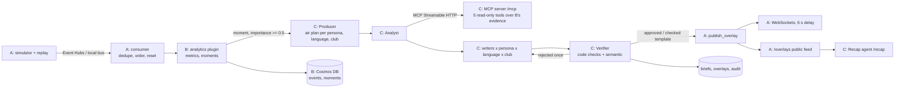

# Integration of Owners A, B and C

Owners A, B and C are complete and integrated: one deterministic pipeline turns a synthetic match into
moments, verified agent overlays, recaps and a public feed, and every seam between owners is tested.
Owner D's viewer is implemented against [HANDOFF_OWNER_D.md](HANDOFF_OWNER_D.md).
See [OWNER_D.md](OWNER_D.md) for deployment status and browser verification.

Status as of 26 Oct 2026: **559 tests pass** (430 before), pyflakes clean, frozen contracts untouched,
Bicep compiles and lints clean, local end-to-end smoke **21/21** (real server, live run, MCP over HTTP).

## How the pieces fit

## Audit: what was planned, what was missing, what was done

| Owner | Plan item | Before | Now |
| --- | --- | --- | --- |
| A | Simulator, scenarios, validator, Event Hubs, replay 1x/5x/20x | done | unchanged |
| A | Container Apps deploy, managed identity, min replicas, budget | done | + App Insights, agent settings, secrets, Cosmos role |
| A | Cached demo match | 24 template overlays (goals, red card) | rebuilt with analytics + agents: 128–218 overlays per match, every agent-worthy moment, 4 personas × 2 languages |
| A | `POST /api/demo/break-it` | helper only, no route | route, reuses the API's match library |
| A/C | Public overlay feed + spec (SHOULD) | spec only | `GET /api/matches/{id}/overlays` (live run or demo) |
| A | Default pipeline | `template_plugin` (goals only) | `analytics + agents`; double-loading is detected |
| B | Metrics, moments, evidence API, Cosmos, golden tests, eval dataset | done | unchanged |
| B | Numeric-faithfulness evaluator, eval run (Mon) | missing | `evals/numeric_faithfulness.py`, runner, CI gate |
| C | Phases 1–6 (templates, Verifier, MCP, agents, workflow, tracing) | done locally | unchanged |
| C | Phase 7: ship to Azure | blocked: cross-tenant Foundry | Foundry **key auth**; `enable-integration` script; App Insights |
| C | Phase 7: rebuild demo with agents | not done | rebuilt (templates); `build-demo-agents` records Foundry output, paced under quota |
| C | Phase 8: evals (raw vs. verified) | missing | `python -m evals.run_agent_eval` |
| C | Phase 8: Favorite Club persona | prompt only, disabled | enabled end to end, per club, EN/AR, respect check |
| C | Phase 8: Recap agent + endpoint | missing | `backend/agents/recap.py`, `GET /api/matches/{id}/recap`, recorded in demo builds |
| C | Analyst uses MCP tools | in-process calls | `AGENT_TOOLS=mcp`: real Streamable HTTP client |

## What changed, by file

- **Agents (C):** `llm.py` key auth · `templates.py`, `producer.py`, `writers.py`, `workflow.py`, `verifier.py`,
  `prompts/writer_club_v1.md`, `prompts/verifier_v1.md` Favorite Club · `recap.py`, `prompts/recap_v1.md` Recap
  agent · `mcp_client.py` MCP transport · `breakit.py` club + shared library · `plugin.py` status, recap,
  demo-build pacing · `config.py` new settings.
- **API (A):** `main.py` feed, recap, Break-it routes, `agents`/`mcp` in health, `club` WebSocket filter ·
  `plugins.py` per-run overlay log · `hub.py` club filter · `demo.py` recorded recaps, overlay sources ·
  `settings.py` default plugins · `cli.py` build-demo recaps + smoke checks.
- **Evals (B/C):** `evals/numeric_faithfulness.py`, `evals/run_agent_eval.py`, `requirements-eval.txt`.
- **Deployment (A):** `main.bicep` (+`cosmos-access.bicep`), `deploy.*`, `enable-integration.*`,
  `build-demo-agents.*`, `integration.env.example`, `integration_env.py`.
- **Tests:** `tests/test_integration.py` (129 tests); three existing tests updated for club overlays and the
  larger demo bundles. **CI:** eval gate and Bicep compile steps.

## Go live (in this order)

1. **Push** this branch, let CI pass, merge to `main`. The image workflow publishes `ghcr.io/<owner>/everyfan-backend:<sha>`.
2. **Roll the image:** `./deployment/update-image.ps1 -Image ghcr.io/<owner>/everyfan-backend:<sha>`.
3. **Owner C** copies *KEY 1* from Azure portal → `everyfan-ai-resource` → Keys and Endpoint, and shares it privately.
4. `copy deployment\integration.env.example deployment\integration.env`, paste `FOUNDRY_API_KEY`
   (and `COSMOS_ENDPOINT` from Owner B). The file is git-ignored.
5. `./deployment/enable-integration.ps1` (add `-CosmosAccount <name> -CosmosResourceGroup <rg>` if Cosmos is in
   the same subscription). It creates App Insights, sets secrets and settings, waits, and runs the smoke test.
   Expect every check to pass; `agents: mode=foundry fast={'deployment': 'everyfan-fast', 'auth': 'key'}`.
6. **Record the agent demo** (Owner C's machine, needs the key or `az login`):
   `./deployment/build-demo-agents.ps1 -Scenario derby_balanced` (~40 min at 24k tokens/min), review the Arabic
   with a native speaker, copy into `demo/`, run the tests, push, roll the new image (steps 1–2).
7. **Evaluate:** `python -m evals.run_agent_eval --mode foundry --limit 30` → `evals/results/latest.md`; paste the
   table into the README (raw writer faithfulness vs. 100% published).
8. Hand the API URL and [HANDOFF_OWNER_D.md](HANDOFF_OWNER_D.md) to Owner D; set `FRONTEND_ORIGIN` to the Static
   Web App URL once it exists (`az containerapp update -n everyfan-api -g rg-everyfan-hackathon --set-env-vars FRONTEND_ORIGIN=https://...`).

## Quota and cost reality

Step 5 evaluation preparation (Owner C): the shared `evals/` runner now retains
raw text, the exact verified fact snapshot and raw-draft coverage; prepares
clients before timed stages; paces Foundry slots sequentially; and distinguishes
provider-reported tokens from conservative charges for failed calls. The
existing numeric evaluator and Owner C's live Verifier share the display-number
matcher, including Arabic-adjacent digits. Regressions are in
`tests/test_agents_evaluation.py`. No Owner A API, simulator or service code,
Owner B analytics, or frozen contracts changed. Results and Owner B's review
handoff are recorded in `OWNER_C_STEP5.md`.

`everyfan-fast` (gpt-4.1-mini) has 30k tokens/minute. One goal now fans out to 10 writers and 10 semantic
checks (~30k tokens), so a **live** match at 20x will exceed the quota and many overlays will be checked
templates. That is the designed, safe behaviour (nothing unverified airs). To show more live agent output:
run live at 1x or 5x, raise the deployment's capacity in the Foundry portal if the student quota allows, or
set `AGENT_CLUB_PERSONA=0` for live. Judges use the cached demo, which costs nothing.

## Left for people, not code

Step 5 update: the completed Foundry evaluation reports 91.0% raw numeric
faithfulness (192/211 valid first drafts) and 100.0% final faithfulness (236/236),
including 149 approved agent drafts and 87 checked fallbacks. The README table,
dated raw/final records and audit were reviewed by the user in place of Owner B;
see [OWNER_C_STEP5.md](OWNER_C_STEP5.md). Step 5 checks: 573 offline tests,
Pyflakes clean, required stub injection gate at 100% published faithfulness.
Foundry trace screenshots and optional model-based quality scores remain outside
this evaluation result.

- Foundry key from Owner C (step 3); Cosmos endpoint and account from Owner B.
- Step 5 review completed by the user in place of Owner B; PR #5 merged (`2aa91ff`).
- Foundry trace screenshots for the README and video. The recorded demo's native
  Arabic review is complete; see [OWNER_C_STEP4.md](OWNER_C_STEP4.md).
- Not built (SHOULD/COULD in the plan, list as roadmap): third language, Single Metric mode, Scenario
  Director, Azure AI Speech narration, studio approval.

## Owner D integration

The new `frontend/` consumes existing REST/WebSocket contracts without modifying
Owner A/B Python source or frozen schemas. `.github/workflows/ci.yml` adds strict
frontend build, timing tests, isolated off-mode browser checks and dependency
audit; deployment of the tested artifact is disabled until the SWA token and
trusted frontend origin are configured. `deployment/azure/frontend.bicep`
provisions a separate Free Static Web App; `deployment/deploy-frontend.ps1`
checks the target subscription's location policy before creating resources.

The currently accessible subscription permits no Static Web Apps region, and
does not contain the EveryFan backend. Public hosting, Owner A's exact-origin
CORS update and physical-device/mobile-network acceptance remain external
dependencies. No policy bypass or unrelated Azure resource change was attempted.
English pitch, recording and final account-holder actions are in
[OWNER_D_DELIVERY.md](OWNER_D_DELIVERY.md).

## Fan-specific interfaces and advanced metrics (authorized C/D/B integration)

The user explicitly authorized backend enhancements for advanced fan statistics.
`backend/analytics/advanced.py` adds deterministic rolling-window/match-to-date
aggregates, passing networks, pass-endpoint territory and shot maps.
`backend/analytics/api.py` mounts the additive, rate-limited `advanced-stats`
endpoint; no Owner A Python files, frozen contracts, existing formulas or moment
rules are changed. The frontend now offers separate Beginner, Tactical, Player
and My Club interfaces that automatically select their commentary persona.
See [OWNER_D_FAN_INTERFACES.md](OWNER_D_FAN_INTERFACES.md) for definitions, source
provenance, missing-data behavior and the required backend+frontend deployment.

The user also requested five evidence-backed extras: team distance/top-speed
leaderboards, actual tracking averages, a Beginner edge explanation, club/rival
summary and important moments, and a momentum timeline for every fan. Authorized
cross-owner changes add `backend/analytics/fan_extras.py`, `tracking_index.py`,
read-only routes in `api.py` and compact source indexing in `evidence.py`.
Existing metric/detector formulas are reused. Tracking timeline cutoffs now
preserve fractional timestamps rather than exposing a sample early via integer
truncation. Empty-event evidence is supported. Frozen contracts and Owner A source
remain unchanged. See [OWNER_D_FAN_EXTRAS.md](OWNER_D_FAN_EXTRAS.md) and the complete
[fan statistics inventory](EVERYFAN_PROJECT_AND_FAN_DATA.md).
