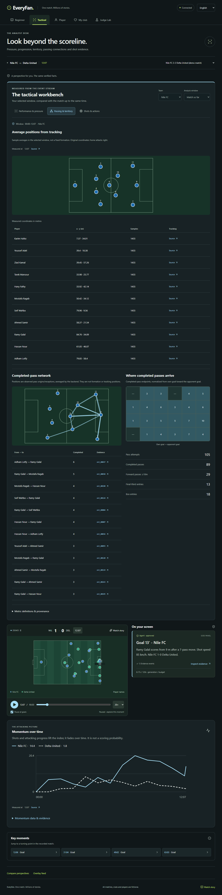
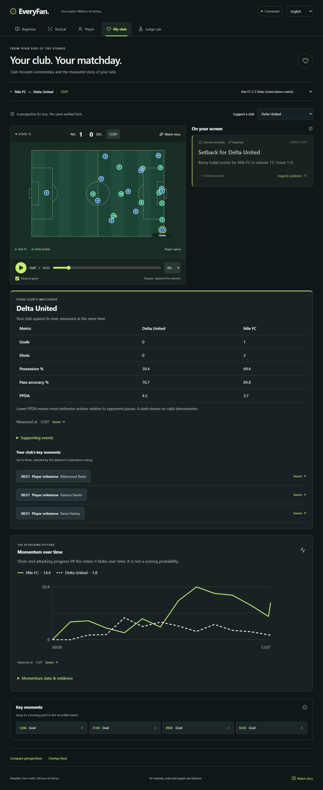

# Evidence-backed fan extras

## Scope

User-requested C/D/B integration adds five fan features while retaining all
existing advanced Tactical statistics and its last-minute, five-minute,
fifteen-minute and match-so-far windows. No model calls, dependencies or new
statistical scoring formulas are introduced. This extends the local viewer;
Owner A must deploy both backend and frontend to make the public version match.

| Interface | Addition |
|---|---|
| Beginner | Plain-language “who is on top” card with its measured control/momentum evidence |
| Tactical | Actual tracking average-position map and per-player source samples, separate from pass-location networks/grid |
| Player | Team top-five cumulative distance and top-speed rankings, with player selection and tracking evidence |
| My club | Club/rival goals, shots, possession, pass accuracy and PPDA; up to three important known club moments |
| All four | Backend-sampled momentum timeline, distinct solid/dashed series, accessible values/evidence table |

The existing dark interface, fan accents, native controls, keyboard interactions
and Arabic RTL/name metadata are retained. Secondary evidence lists load when
expanded; the first sixteen links accompany a full snapshot containing all IDs.

## Additive API

`GET /api/matches/{id}/fan-stats?at_s=5400&window_s=300`

Both time values are bounded to the match; `at_s` is 0–5400 and `window_s` is
greater than zero and at most 5400. Existing read rate limits apply. Invalid
queries return 422, missing matches return 404. The read-only endpoint runs
analytics in a worker thread and returns:

```text
match_id, at_s, window_s, window_start_s
definitions_version, definitions
control_window_s
on_top { status: leading | mixed | insufficient, team_id }
teams[team_id]
  summary                 existing same-cutoff team snapshot, including match PPDA
  average_positions[]     player_id, x_m, y_m, sample_count, first_frame, last_frame
  leaderboards
    distance_km[]         rank, player_id, value, tracking_until_s
    top_speed_kmh[]       same fields
  key_moments[]           existing moment contracts and source event IDs
momentum_timeline[]       at_s, teams[team_id] { value, evidence_event_ids }
evidence_event_ids[]      all known events supporting the aggregate snapshot
```

`GET /api/matches/{id}/players/{pid}/tracking-samples?at_s=5400&window_s=5400&offset=0&limit=200`

Returns original `frame`, `period`, `at_s`, `x_m`, `y_m` records, plus `total`,
`offset` and `next_offset`. The maximum page size is 1000; negative offsets,
invalid bounds and zero windows return 422. Unknown players return 404. Known
players with no source samples receive an empty list. Follow `next_offset` to
inspect all samples rather than treating the first page as the whole window.

## Measurement and provenance decisions

- **Tracking averages:** sample-weighted mean over `(at_s-window_s, at_s]`.
  Whole-match tracking (`window_s=5400`) includes the kickoff sample. Only actual
  per-frame player entries count, so missing players never gain fabricated
  off-ball positions. Coordinates retain the original pitch orientation.
- **Compact cache:** `PlayerPositions` stores packed numeric arrays for times,
  frame IDs, periods, raw coordinates and prefix sums. This avoids retaining a
  second set of full Pydantic frames in the four-match evidence cache. Each
  average is a pair of prefix-sum differences after binary searches. Source
  records are paginated directly from the same arrays.
- **Distance/speed:** use the existing `PlayerTracker` timelines, sampled once
  per match second. Distance skips frame gaps/half changes; top speed is the
  maximum three-frame moving average at 2 Hz. Rank unrounded values, then player
  ID for stable ties; return five or fewer players with known tracking. Rankings
  include completed workloads after substitution, not just active players.
  A top-speed ranking does not claim sprint counts. Source cutoffs use the true
  sample timestamp, including fractional times, and never a future sample
  truncated to an integer second.
- **Beginner edge:** require both rounded existing last-five-minute control and
  current momentum to favor the same club strictly. Equal or disagreeing
  signals mean mixed; unavailable control means insufficient. The UI explains
  this without asserting a winner or creating a composite metric.
- **Club comparison:** both teams use the existing same-time `team_snapshot`.
  PPDA is null if its defensive-action denominator is absent. The key-moment
  list is club-only, importance descending, time/ID ascending, at most three,
  and restricted to events already known at `at_s`.
- **Momentum:** call the existing engine at every 60-second point and the exact
  cutoff. Existing configuration defines event weights and exponential decay;
  every contributing event within the eight-decay-period support is included,
  not just the last few source IDs. No frontend history sampling or frontend
  metric calculations supply the chart. Frontend arithmetic only maps returned
  values to drawing coordinates and formats units.
- **Replay behavior:** new fan snapshots poll every five real seconds; advanced
  snapshots keep their ten-second poll. Both refresh after 60 match seconds of
  progress, backwards seeks, window changes and replay resets. Abort stale
  requests and hide snapshots later than the current replay clock.

The full fan/statistics inventory is in
[EVERYFAN_PROJECT_AND_FAN_DATA.md](EVERYFAN_PROJECT_AND_FAN_DATA.md).

## Verification on 27 October 2026

- Full Python suite: **598 passed**; Pyflakes clean.
- Frontend: **7 unit tests**, production build and formatting pass.
- Isolated Chrome acceptance: **8 passed**, including all four Tactical windows,
  evidence-value reconciliation, player/club selection, populated English/Arabic
  accessibility, narrow mobile layouts, full replay and live-host permissions.
- Required stub evaluation: **100% published numeric faithfulness (236/236)**;
  all **80** injected invented-number drafts caught. No real models or Azure calls.

CI also exposed transient low contrast during the existing commentary-card fade.
Card entrance motion now uses translation at full opacity, preserving readable
text throughout the animation. The seek regression waits for the requested
positive as-of time rather than mistaking the replay's intermediate zero reset
for the completed seek. Both accessibility and numeric evidence checks stay enabled.

`tests/test_agents_fan_extras.py` checks hand-calculated coordinate means and
physical measurements, source pagination, stable top-five ties, absent tracking,
fractional cutoffs, inactive-player behavior, all on-top decision states,
configured momentum decay/full provenance, club moment selection and endpoint
validation. Existing advanced analytics tests cover all four synthetic scenarios.

`frontend/e2e/fan-extras.spec.ts` checks all four Tactical windows, reconciles
displayed positions/rankings/momentum with actual evidence responses, follows a
tracking source link, selects leaderboard players and clubs, and audits populated
English/Arabic views at desktop and 320px widths. Existing tests cover full replay,
one preserved connection across fans, keyboard controls, live-host permissions,
feed, recap, evidence dialogs and bootstrap recovery.

See the PR for the final CI result. Deployment and human native review of the
newly added Arabic copy remain separate from automated verification.

## Verified local screenshots




