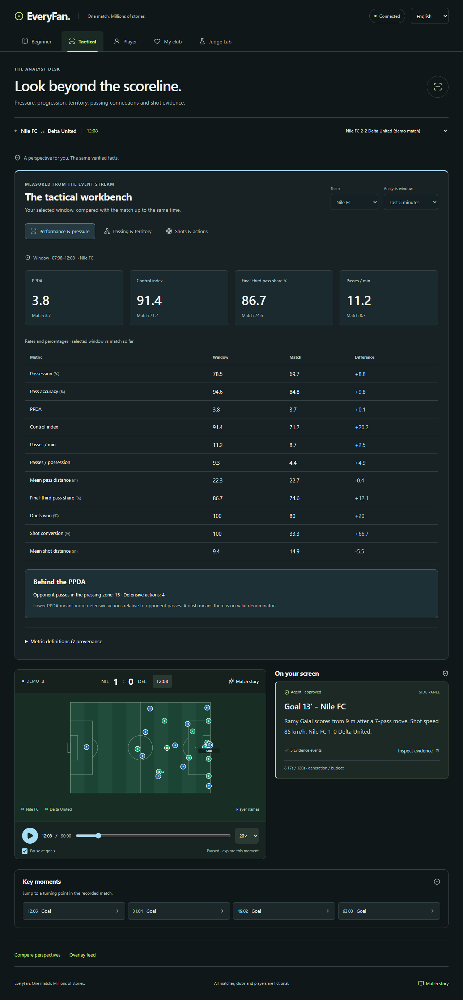
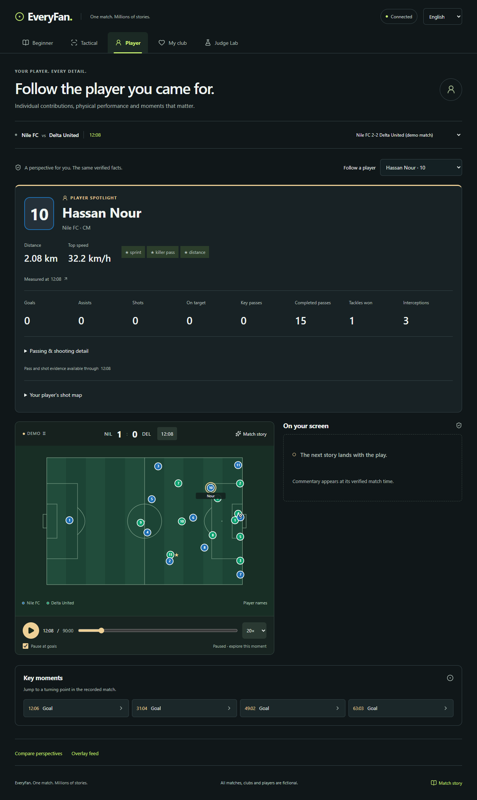

# Fan-specific interfaces and advanced analytics

This supersedes the earlier feature-based screen split. The user clarified that
Beginner, Tactical and Player each need a dedicated interface and explicitly
authorized extending the backend for advanced statistics. My Club remains a
fourth fan experience. Judge Lab, comparison and the public feed remain available.

## Experiences

- **Beginner** (`/#/beginner`): a large replay pitch, plain-language beginner
  commentary, shots/possession comparison and simple football explanations.
  Detailed tactical tables are absent.
- **Tactical** (`/#/tactical`): a dedicated workbench, tactical commentary,
  team/window selectors, server-measured rates against match-to-date baselines,
  PPDA components, passing networks, territory grid, shot evidence and defensive
  action counts. The pitch is supporting context below the analysis.
- **Player** (`/#/player`): metadata profile/jersey, a selected player, measured
  distance and top speed, earned badges, goals/assists/shots/key passes/completed
  passes/tackles/interceptions, detailed passing and shooting, individual shot
  evidence and player-specific commentary. Selecting a dot opens that player.
- **My club** (`/#/club`): club selection, club-persona commentary and the club's
  goals, shots, possession and passing summary.

All screens share one replay and clock, but automatically select the matching
commentary persona. A player or club choice is retained when changing interfaces.
Legacy `/#/match` and `/#/insights` links resolve to Beginner/Tactical. Comparison
and feed are secondary navigation links. Judge Lab resumes the selected persona.

## Additive backend API

`GET /api/matches/{match_id}/advanced-stats?at_s=3784&window_s=300`

`at_s` is 0–5400; `window_s` is greater than 0 and at most 5400. The existing
analytics read rate limit applies. Missing matches return 404; invalid query
parameters return 422. The endpoint is deterministic, read-only, and never calls
a model. The UI polls it every ten real seconds only for Tactical/Player and
refreshes on window changes and replay resets. All calculations happen in Python.

Response fields:

- `at_s`, `window_start_s`, `window_s`, `definitions_version`, `definitions`.
- `teams[team_id].current`, `.match`, `.deltas`: selected window, match so far,
  and server-calculated differences. Metrics include possession, pass accuracy,
  PPDA/components, control, pass rate, passes per possession, mean pass length,
  forward passes, third/box entries, territorial pass share, shooting/conversion,
  recoveries, tackles/interceptions, duels, corners and fouls.
- Per-team `pass_network`, `territory`, `shot_map`, `evidence_event_ids`.
  Source events can be opened through the existing event endpoint.

## Definitions and limits

The window is **(at_s − window_s, at_s]**, clipped at kickoff. Neither baselines
nor maps contain future events. A missing denominator is `null`, rendered as a
dash; zero observed events remain zero. Rates/percentages are appropriate for
comparing different durations; event counts are presented separately.

- Forward passes ≥10 m: **completed** passes gaining at least ten metres along
  the team's attacking x direction. This is a named project metric, not a claim
  of compatibility with a provider's progressive-pass model.
- Final-third entries: completed passes/carries crossing from outside to inside
  the attacking third. Box entries use the existing penalty-box geometry.
- Final-third pass share: a team's share of both teams' completed passes ending
  in their respective attacking third. It is a pass-based territory proxy, not
  possession or all touches.
- PPDA reuses Owner B's opponent-zone definition and action vocabulary. The
  interface exposes its numerator and denominator. Lower means more defensive
  actions relative to opponent passes; it is not proof of a successful press.
- High recoveries: recovery events in the attacking third. Tackles and
  interceptions retain their own counters; they are not counted as recoveries.
- Shot conversion uses shot outcomes, without counting separate goal events
  again. Distances/speeds reuse the measured geometry/path calculations.
- Passing network: up to twelve strongest directed completed-pass links.
  Node coordinates are averages of observed pass origins/receptions, not player
  tracking positions, formation locations, or off-ball movement. Each link/node
  retains source IDs. Only teammates with valid metadata IDs are linked.
- Territory grid: a 6×4 grid of completed-pass endpoints normalized so either
  team attacks toward increasing x. It is not a player heatmap.
- No xG/xA, ratings, forecasts or calibrated probabilistic models are invented.
  Player passing accuracy is the existing backend ratio formatted as a percent.

## Integration and deployment

The new Python module is `backend/analytics/advanced.py`; the only existing
backend change adds a route in `backend/analytics/api.py`. This is the expressly
authorized cross-owner integration, recorded in [INTEGRATION.md](INTEGRATION.md).
Frozen schemas, moment rules, existing metric formulas and demo bundles remain
unchanged. No new dependencies are added.

Owner A must deploy this backend revision as well as the frontend. An older
backend lacks `/advanced-stats`; the interface shows an analysis error with a
retry instead of fabricating values. Normal local testing runs agents off and
does not spend Foundry tokens. Screenshots and the final video must be updated
to this fan-specific interface before submission; new Arabic copy needs human
native review.

## Verification on 2026-10-27 (Cairo)

- 583 Python tests pass, including ten advanced-statistics cases: hand-calculated
  counts/percentages, both attacking directions, window boundaries, missing
  denominators, source resolution, no future leakage, API validation and
  reconciliation with existing metrics across all four scenarios.
- Pyflakes clean; strict TypeScript production build and formatting pass.
- Seven scheduler unit tests and seven isolated Chrome acceptance scenarios pass.
  Browser checks compare the displayed PPDA with the actual advanced API response,
  switch analysis windows, exercise maps/player selection, preserve one paused
  replay between fan types, and cover the full replay and live-host controls.
- All interfaces pass automated WCAG A/AA checks, English/Arabic layouts at
  320/375/768/1440 widths, landscape, reduced motion and enlarged phone layout.
- The required stub injection evaluation remains 100% published numeric
  faithfulness (236/236); all 80 injected drafts are caught, with no model calls.
- Normal localhost API/proxy smoke: healthy/off/local; advanced stats at 3784 s
  in a 300 s window returned Nile PPDA 1.5, twelve displayed network links and
  two shot records. These are measured response values, not scenario-wide claims.

