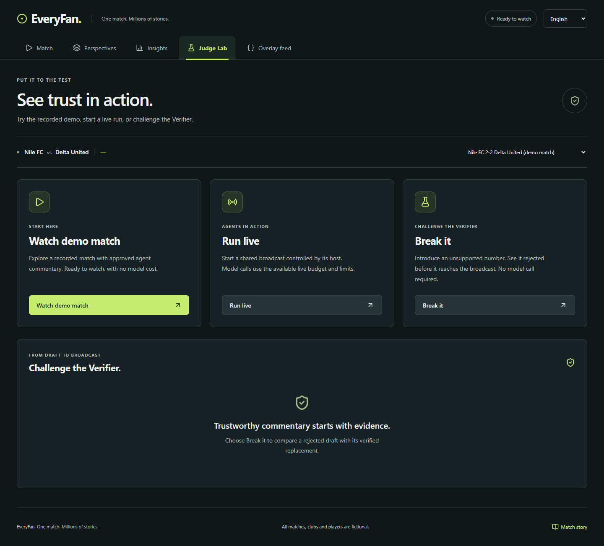

# Independent viewer screens

The user requested separate interfaces reached by buttons at the top, plus an
overall UX improvement. The redesign follows the explicitly invoked
`ui-ux-pro-max` skill's accessibility, navigation, responsive layout and visual
hierarchy guidance. Its installed `scripts` and `data` entries are unresolved
text symlink placeholders, so its search CLI could not run; the supplied skill
instructions were applied directly. The existing application remains React web.

## Design contract

- Five primary destinations: Match, Perspectives, Insights, Judge Lab, Overlay
  feed. Each replaces the main screen instead of appending more panels to it.
- Match contains the pitch, replay controls, selected commentary and preferences.
  Perspectives presents four commentary views without a repeated pitch.
  Insights contains measured indices and player statistics. Judge Lab contains
  demo/live entry points and an inline rejection experiment. Feed contains the
  published records and evidence links.
  Feed search/persona filters and incremental loading keep the list manageable.
- One shared match connection/clock, selected player/club, language and preferences
  survive navigation. No screen switch starts another live run or model call.
- Hash URLs (`/#/match`, `/#/perspectives`, `/#/insights`, `/#/lab`, `/#/feed`)
  support direct links, refresh and browser Back/Forward without hosting changes.
  Browser refresh starts a fresh viewer connection only after the user requests
  playback. Navigation restores per-screen scroll and focuses its main heading.
- Keep the established ink/green/lime identity. Use larger, readable typography,
  quiet borders, consistent spacing, clear selected states and 44px controls.
  Use native selects, Lucide icons, no external fonts/assets or decorative charts.
- Global language control, full Arabic RTL and isolated score/time digits.
  Reflow every screen on phone/landscape, support zoom and reduced motion.
  The top navigation remains reachable while scrolling.
- Evidence and recap remain secondary dialogs with native focus and Escape
  behavior; primary navigation never opens a dialog. Break it shows its result
  inline within Judge Lab.

## Review boundaries

No backend, analytics or frozen contracts change. Football facts, timing and
verification remain supplied by the existing API. `useMatch` owns the persistent
connection above the screens. Navigation, pitch/controls, comparison, timeline
and Judge Lab are separate modules. Tests verify screen separation, one socket,
paused clock preservation, browser history/deep links, responsive English/Arabic,
contrast, keyboard focus and reduced motion in addition to existing replay tests.

The original demo video is a recording of the earlier interface. Its recording
source is updated with the new destinations; the final submission recording must
be refreshed after the public deployment and UI approval. New Arabic copy still
needs human native-speaker review.

## Verification (2026-10-27, Cairo)

- 573 Python tests passed; Pyflakes clean.
- Required stub injection evaluation: 100% published numeric faithfulness across
  236 outputs, with all 80 injected drafts caught.
- Strict TypeScript/production build, formatting and seven scheduler tests pass.
- Seven isolated Chrome acceptance scenarios pass, including a full replay,
  navigation state/history, all-screen English/Arabic accessibility, search and
  perspective filters, native modal behavior, live ownership and error recovery.
- Tested widths 320, 375, 768 and 1440, phone landscape, 150% phone zoom and reduced
  motion. The zoom test caught a header/minimum-width issue that was fixed.
- Normal local viewer verified at `http://localhost:5173/#/match`; API reports
  healthy, off-mode agents and local transport. No paid models were called.

